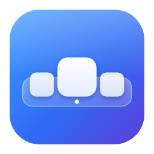

<p align="center">
  
</p>

<h1 align="center">Dockbox</h1>

<p align="center">Um clone do Dock do macOS para Windows, feito em C# + WPF (.NET 8).</p>

## O que já existe

- Dock sem borda, transparente e sempre no topo, que **não rouba o foco** e não aparece no Alt+Tab.
- Visual estilo macOS: fundo de vidro com gradiente, sombra, borda clara, rótulo com o nome do item.
- Ampliação suave ao passar o mouse e animação de "pulo" ao abrir um app.
- Ponto embaixo dos apps abertos (inclusive apps da Microsoft Store); clique num app aberto traz a janela para frente, clique de novo minimiza.
- Apps abertos que não estão fixados aparecem depois dos fixados e somem ao fechar; botão direito → **Manter no Dock** fixa.
  Ctrl + clique abre uma nova janela.
- Arraste um app, atalho, pasta ou arquivo para o Dock para fixá-lo (os ícones abrem espaço mostrando onde ele entra);
  solte arquivos sobre um app para abri-los com ele.
- Arraste um ícone do Dock para o lado para reordenar, ou para fora do Dock para remover.
- **Gerenciar Dock** (botão direito no Dock): adicionar apps do Menu Iniciar e da Microsoft Store, arquivos e pastas; remover, reordenar e editar.
- **Widgets**: relógio, calendário, clima (Open-Meteo), CPU/RAM, bateria, mídia tocando agora e Lixeira.
- **Estilo**: tema automático/claro/escuro/personalizado, cor de fundo, cor de destaque, opacidade,
  cantos arredondados, tamanho dos ícones, intensidade da ampliação, posição (embaixo, em cima, esquerda, direita) e monitor (principal, escolhido ou seguir o mouse).
- Reserva espaço na tela: janelas maximizadas param antes do Dock, como na barra de tarefas (dá para desligar).
- Ocultar automaticamente: o Dock sai da tela e volta quando o mouse encosta na borda.
- Ícone na área de notificação (bandeja) com atalhos para Gerenciar Dock e Sair.
- Acessível: **Win+Shift+D** leva o foco ao Dock (setas, Enter, Shift+F10, Esc), nomes para o Narrador/NVDA,
  sem animações quando o Windows pede e cores do alto contraste.
- Ícone pula quando um app pede atenção e mostra contador vermelho (lido do título, como "(3) WhatsApp").
- Miniaturas ao vivo das janelas ao passar o mouse num app com várias janelas (clique traz, X fecha).
- Fundo de vidro com desfoque de verdade do que está atrás (Windows 10 e 11).
- Opção de esconder a barra de tarefas do Windows (ela volta ao fechar o Dockbox).
- Em português, inglês e espanhol (segue o idioma do Windows ou o que você escolher).
- Iniciar junto com o Windows (opcional).

## Como rodar no Windows

Opção A, sem instalar nada: baixe o zip da versão mais recente na pasta
[`releases/`](releases/) ou na página
[Releases](https://github.com/victorgabriel08fs/dockbox/releases), extraia e abra o `Dockbox.exe`.
Builds de desenvolvimento ficam na aba **Actions** (workflow *build*, artefato `Dockbox-win-x64`).

Opção B, compilando:

1. Instale o [.NET 8 SDK](https://dotnet.microsoft.com/download/dotnet/8.0) (x64).
2. No PowerShell, dentro da pasta do repositório:

   ```powershell
   dotnet run --project src/Dockbox
   ```

   Ou gere um executável:

   ```powershell
   dotnet publish src/Dockbox -c Release -r win-x64 --self-contained true -p:PublishSingleFile=true -o out
   .\out\Dockbox.exe
   ```

Também dá para abrir `Dockbox.sln` no Visual Studio 2022 e apertar F5.

## Configurações

Tudo fica em `%APPDATA%\Dockbox\settings.json` e é editado pela janela **Gerenciar Dock**.
Se o arquivo for corrompido, uma cópia com data é guardada antes de voltar aos padrões.
Um `pinned.json` da versão anterior é importado automaticamente.

## Limitações conhecidas do MVP

- A barra de tarefas do Windows continua visível.
- O fundo imita vidro, mas não desfoca o que está atrás.

Esses pontos estão previstos nas fases 2 e 3.

## Documentação e testes

- [Guia do usuário](docs/GUIA-DO-USUARIO.md): instalar, usar, Gerenciar Dock, widgets, privacidade do clima e problemas comuns.
- [Arquitetura](docs/ARQUITETURA.md): como o código está organizado e como criar um widget.
- [Traduções](docs/TRADUCAO.md): como corrigir um texto ou acrescentar um idioma.
- [Testes](docs/TESTES.md): testes automáticos (`dotnet test tests/Dockbox.Tests`, só no Windows) e checklist de teste manual.

## Versões

O Dockbox usa [Versionamento Semântico](https://semver.org/lang/pt-BR/) com tags `vX.Y.Z`.
A versão atual fica em `src/Dockbox/Dockbox.csproj` (`<Version>`), o histórico no
[CHANGELOG.md](CHANGELOG.md) e os executáveis de cada versão em [`releases/`](releases/),
onde também está o passo a passo para lançar uma versão nova.

## Estrutura

| Pasta | Conteúdo |
|---|---|
| `Core/` | Configurações (`DockSettings`), tema e cores; sem dependência de janela |
| `Services/` | Ícones, atalhos, apps abertos, clima, mídia, lixeira, estatísticas do sistema |
| `Widgets/` | Um arquivo por widget, todos derivados de `DockWidget` |
| `Views/` | Janela do Dock, Gerenciar Dock e seletor de apps |
| `Interop/` | Declarações Win32 |
| `Assets/` | Ícone do app (`.ico`) e logo usados nas janelas; fontes em [`assets/brand/`](assets/brand/) |
